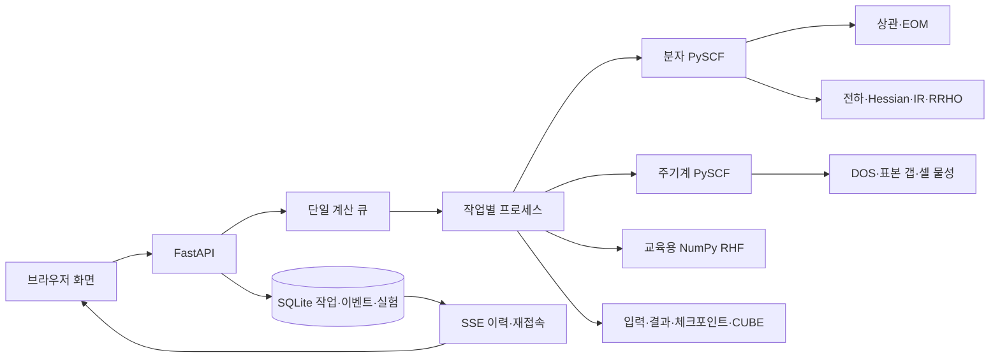

# 실행 구조와 개발 인터페이스

## 구성

브라우저는 React·TypeScript, 차트는 Plotly, 원자·격자·등가면은 3Dmol.js를 사용한다. FastAPI가 정적 화면과 API를 제공하며, 계산은 API 프로세스와 분리된 작업 프로세스에서 실행한다.



계산 작업과 3D 격자 생성 작업은 같은 순차 큐를 사용한다. 브라우저에서 밀도를 요청했다고 별도 무제한 계산을 실행하지 않는다. 초기 운영 모델은 한 사용자·한 서버·한 계산 큐다.

## 작업 수명과 이벤트

상태는 `queued`, `running`, `succeeded`, `unconverged`, `failed`, `cancelled`, `interrupted`로 구분한다. 수렴 실패는 정상 수렴과 별개이며, 실행 도중 생성된 이력은 최종 성공 여부와 무관하게 보관할 수 있다.

각 이벤트는 작업 ID, 순번 `seq`, 시간, 종류 `type`, 내용 `data`를 가진다. 대표 이벤트는 `scf_iteration`, `correlation_iteration`, `optimization_step`, `stage`, `warning`, `status`다. 상관·EOM·Hessian·IR 변위 등의 진행은 각 단계의 실제 callback 또는 완료 이벤트로 기록한다. 순번과 작업 ID로 이벤트를 합치며 이전 작업의 결과를 새 작업과 섞지 않는다.

SSE는 `after` 또는 `Last-Event-ID`로 저장된 이벤트를 재생한다. 이벤트의 전송 성공은 계산 성공과 다른 의미다. 최종 상태는 엔진의 종료와 최종 수렴 필드를 확인한 뒤 저장한다.

취소는 해당 서버가 소유한 작업 프로세스에만 적용한다. 취소와 정상 완료가 경쟁할 수 있으므로 터미널 상태 갱신은 조건부로 처리한다. 서버 종료·재시작 후 복구 불가능한 실행 상태는 `interrupted`로 구분한다.

## HTTP API

기본 prefix는 `/api`다. 실행 중인 앱의 OpenAPI 문서가 타입과 검증 규칙의 최종 기준이다.

| 메서드·경로 | 역할 |
| --- | --- |
| `GET /health` | 서버 상태 확인 |
| `GET /examples` | 예제 구조·설정 |
| `GET /catalog` | 방법·함수형·기저·학습 안내 |
| `GET /catalog/bases?q=...&elements=...` | BSE 기저 검색 |
| `POST /structures/parse` | `{format: "xyz" 또는 "cif", content: "..."}`를 구조로 변환 |
| `GET /jobs` | 저장된 작업 목록 |
| `POST /jobs` | 검증한 설정으로 작업 생성 |
| `GET /jobs/{id}` | 설정·상태·최종 결과·오류 |
| `POST /jobs/{id}/cancel` | 작업 취소 |
| `GET /jobs/{id}/events?after=0` | SSE 진행 이벤트 |
| `GET /jobs/{id}/history` | 저장된 이벤트 배열 |
| `GET /jobs/{id}/artifacts` | 생성된 파일 목록 |
| `GET /jobs/{id}/artifacts/{filename}` | 지정된 작업 파일 다운로드 |
| `GET /jobs/{id}/export?format=...` | JSON·CSV·XYZ·CIF 내보내기 |
| `GET /jobs/{id}/data?kind=...` | 여기·EOM·밴드·DOS·진동·전하·최적화·상관 수치 CSV |
| `GET /jobs/{id}/report` | 저장 결과와 SCF 이력의 독립 HTML 보고서 |
| `GET /jobs/{id}/bundle` | 종료한 작업의 입력·결과·산출물·SHA-256 manifest ZIP |
| `POST /jobs/{id}/volumes` | 기존 계산에서 밀도·오비탈·NTO CUBE 생성 작업 |
| `GET /experiments/templates` | 학습 실험의 고정 조건·기저·해설 |
| `GET /experiments` | 저장된 실험 목록과 요약 |
| `POST /experiments` | 고유 `request_id`로 선택한 실험과 모든 표본 계산을 함께 생성 |
| `GET /experiments/{id}` | 순서가 있는 결과·비교 가능성·관찰 해설 |
| `POST /experiments/{id}/cancel` | 해당 실험의 대기·실행 중 작업만 취소 |
| `GET /experiments/{id}/export?format=json\|csv` | 입력·결과·기저·이력 또는 비교 표 다운로드 |

입력 좌표·격자는 Å, 계산 에너지는 원본 Hartree, 표시 여기·밴드 에너지는 eV다. 스핀은 `Nα − Nβ`다. 입력과 결과에 단위를 함께 남겨 무언의 변환을 피한다.

예를 들어 H₂ RHF 단일점 작업은 다음 형태다. 생략된 설정은 서버 기본값을 사용하며 저장된 작업의 전체 설정에서 확인한다.

```json
{
  "name": "H2 RHF",
  "domain": "molecule",
  "task": "single_point",
  "atoms": [
    {"symbol": "H", "position": [0, 0, 0]},
    {"symbol": "H", "position": [0, 0, 0.74]}
  ],
  "charge": 0,
  "spin": 0,
  "method": "HF",
  "restricted": true,
  "basis": "sto-3g"
}
```

격자 생성 요청은 `kind`, `index`, `spin`, `grid`를 사용한다. `index`는 API에서 0부터 시작하며, 화면에 표시하는 오비탈·여기 상태 번호와 변환 규칙을 맞춰야 한다.

```json
{"kind": "density", "index": 0, "spin": 0, "grid": 40}
```

## 학습 실험과 기존 계산의 연결

학습 실험은 별도 계산 엔진을 만들지 않는다. `experiments`와 `experiment_jobs` 테이블에 고정 조건과 순서를 저장하고 기존 작업 큐를 사용한다. 실험과 모든 표본 작업은 하나의 SQLite 트랜잭션으로 생성하며, 시작 요청을 재전송하면 같은 ID의 기존 실험을 반환한다. 같은 요청 ID로 다른 조건을 보내면 HTTP 409를 반환한다.

실험 화면은 실행 중 요약을 1초 간격으로 조회하고, 개별 계산을 열면 기존 SSE 수렴 이력을 사용한다. 결과를 비교하기 전에 전체 입력·구조·엔진 버전·최종 수렴을 확인한다. 실패한 중간 계산을 건너뛴 ΔE나 보간값은 생성하지 않는다. 결정의 `energy_hartree`는 셀 전체 값이고 `energy_per_atom_hartree`는 원자당 값이다.

v0.3의 `definition`에는 템플릿 ID·버전·변수·표본 값과 순서·제목·해설·참고문헌·`expected_specs`를 생성 시 복사해 저장한다. 기록을 다시 열 때 현재 카탈로그의 기본값으로 입력을 재구성하지 않는다. v0.2 데이터베이스에는 nullable `definition` 열만 추가하고 기존 작업·이벤트를 보존한다. 예전 기저 실험은 저장된 `base_spec`과 `bases`로만 비교 조건을 복원한다. 실제 JSON 내보내기에 이 고정 정의와 결과를 함께 포함한다.

새 템플릿을 추가할 때는 다음 순서를 따른다.

1. `experiment_science.py`에 새로운 버전 ID, 변수·표본 값·단위·설명과 고정 입력을 정의한다. 기존 ID의 과학적 조건을 덮어쓰지 않는다.
2. `build_specs`에서 전체 입력을 `JobSpec`으로 검증한다. 의도한 한 변수 외의 입력이 바뀌지 않는지 확인하고, 새 변수에는 고정 조건과 해석 규칙을 명시한다.
3. `experiments.py`의 허용 템플릿 목록을 갱신한다. 생성 시 `freeze_definition`으로 전체 입력과 표시 자료를 보존한다.
4. 실제 계산과 직접 엔진 호출, 입력 변조·미수렴·취소·재전송·기존 기록 복원 검사를 추가한다. 일반화된 화면의 축·단위·고정 조건과 내보내기를 확인한다.

현재 기저·DFT 격자·함수형·H₂ 결합 거리·결정 k점·FFT 격자·전자 상관의 7종을 제공한다. 기본 실험 관리의 구현 과정은 [v0.2 개발 기록](development-v02.md), 현재 과학적 범위는 [방법론 안내](methods.md)에 정리했다.

## 엔진 어댑터

엔진은 다음 두 진입점을 제공한다.

```python
def run(spec: dict, emit, workdir: Path) -> dict: ...
def generate_volume(parent_dir: Path, request: dict, output_dir: Path) -> dict: ...
```

`run`은 JSON으로 저장 가능한 유한 수치 또는 `null`만 반환한다. 공통 필드는 `converged`, `energy_hartree`, `atoms`, `lattice`, `engine`이며, 분자와 결정은 필요한 결과를 추가한다. 새 엔진이 기존 필드와 다른 물리량을 반환한다면 이름과 단위를 별도로 정의한다.

실제 반복 callback에서 `emit("scf_iteration", data)`를 호출한다. 최적화에서는 바깥 단계 번호를 함께 기록한다. 계산기가 마지막 callback 이후 추가 수렴 검사를 수행할 수 있으므로 `kernel()` 등의 반환 이후 최종 상태를 확인해야 한다.

작업 폴더에는 입력 `input.json`, 결과 `result.json`, 계산 로그와 필요한 체크포인트·배열을 저장한다. 체크포인트의 구조는 각 엔진이 소유하며, 볼륨 생성은 해당 엔진의 저장 자료를 읽는다.

분자 어댑터는 `correlated.py`의 상관·EOM 계산과 `properties.py`의 전하·진동 분석을 조합한다. 전체 상관 에너지와 RHF 참조 에너지는 별도 필드이며, 결과의 궤도·밀도·전하·쌍극자 참조를 명시한다. 상관 수렴, EOM 근, 진동 응답·IR 변위 수렴은 요청한 작업의 최종 성공 조건에 포함한다. 주기계는 `periodic_analysis.py`에서 저장된 SCF k점 고유값과 점유수의 DOS, 계산한 점들의 갭, 셀 물성을 분석한다.

## 보고서·내보내기와 명령행 실행

`reports.py`는 저장된 결과를 읽어 CSV·독립 HTML 보고서를 만들며 재계산하지 않는다. CSV의 `kind`는 `excitations`, `eom`, `bands`, `dos`, `frequencies`, `charges`, `optimization`, `correlation`이다. 계산하지 않은 물리량은 빈칸으로 남기며, 요청 데이터가 없는 작업에는 HTTP 422를 반환한다. HTML 보고서는 외부 스크립트·폰트·CDN 없이 저장·인쇄할 수 있다.

ZIP 묶음은 터미널 상태의 작업에 제공한다. 원래 입력, 작업·이벤트 JSON, HTML 보고서와 기저 정의·로그·체크포인트·배열을 담고 각 파일의 크기와 SHA-256을 기록한다. 실행 중에는 HTTP 409, 산출물 합계가 256 MiB를 넘으면 HTTP 413으로 응답하고 개별 다운로드를 이용한다. 이 묶음은 원본 자료 보관용이며 엔진 버전이 다른 환경에서 수치 재현을 자동 보장하지 않는다.

브라우저 없이도 같은 입력 검증·작업 큐·저장 형식을 사용할 수 있다.

```bash
uv run quantum-lab doctor --json
uv run quantum-lab examples
uv run quantum-lab example h2 > h2.json
uv run quantum-lab run h2.json --data-dir .quantum-lab-cli --json-events
```

`doctor`는 설치 메타데이터·로컬 자원·화면 빌드 상태를 확인하며 계산이나 실제 WSL2 검증을 실행하지 않는다. `run`은 서버와 다른 데이터 폴더를 사용하고, 실행 중 서버 또는 미완료 작업이 있는 폴더를 가로채지 않는다. 종료 코드는 성공 0, 미수렴 2, 입력·실행 오류 1, 사용자 중단 130이다. 표준 입력의 JSON은 `run -`로 받을 수 있다. CUBE 생성 작업은 저장된 원본이 필요하므로 API의 `/volumes`를 사용한다.

## 새 기능을 추가하는 순서

1. 대상 물리량, 적용 범위, 엔진 버전과 공식 근거를 정리한다.
2. 실제 입력과 직접 엔진 호출로 작고 재현 가능한 기준 결과를 만든다.
3. 타입·검증·기능표에 지원 조합을 추가한다. 이름이 파싱된다는 이유만으로 검증됨으로 표시하지 않는다.
4. 어댑터와 저장 결과를 구현하고 최종 수렴·오류·취소 경로를 검증한다.
5. 단위와 과학적 의미가 정확한 시각화·해설을 추가한다.
6. 실제 계산과 브라우저 흐름을 검증하고 증거를 기록한다.

계산 비용·수렴·입력 지원이 다른 외부 엔진은 별도 어댑터를 사용한다. 사용자가 요청한 방법을 다른 방법으로 조용히 대체하거나 로그에서 숫자만 추출해 동일 결과 타입으로 위장하지 않는다.

## 운영과 확장 경계

초기 서버는 로컬 사용에 맞춰 루프백 주소에서 동작한다. 원격 사용자 인증, 다중 사용자 격리, 클러스터 스케줄러, 상용 서비스의 할당량·과금은 포함하지 않는다.

외부 배포 전에 프런트엔드 빌드 파일의 패키징, 의존성·기저 데이터의 재배포 조건, 데이터 마이그레이션과 버전 정책을 별도 확인한다. 현재 개발 경로는 저장소 체크아웃에서 Python 환경과 프런트엔드 빌드를 함께 사용한다.
