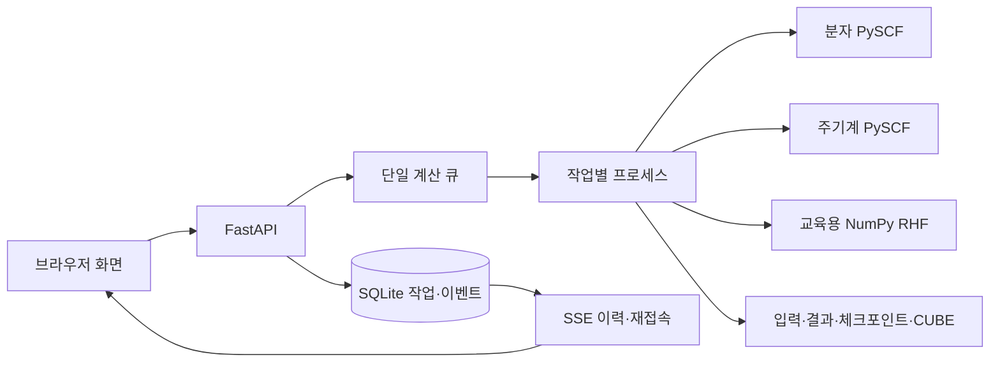

# 실행 구조와 개발 인터페이스

## 구성

브라우저는 React·TypeScript, 차트는 Plotly, 원자·격자·등가면은 3Dmol.js를 사용한다. FastAPI가 정적 화면과 API를 제공하며, 계산은 API 프로세스와 분리된 작업 프로세스에서 실행한다.



계산 작업과 3D 격자 생성 작업은 같은 순차 큐를 사용한다. 브라우저에서 밀도를 요청했다고 별도 무제한 계산을 실행하지 않는다. 초기 운영 모델은 한 사용자·한 서버·한 계산 큐다.

## 작업 수명과 이벤트

상태는 `queued`, `running`, `succeeded`, `unconverged`, `failed`, `cancelled`, `interrupted`로 구분한다. 수렴 실패는 정상 수렴과 별개이며, 실행 도중 생성된 이력은 최종 성공 여부와 무관하게 보관할 수 있다.

각 이벤트는 작업 ID, 순번 `seq`, 시간, 종류 `type`, 내용 `data`를 가진다. 대표 이벤트는 `scf_iteration`, `optimization_step`, `stage`, `warning`, `status`다. 순번과 작업 ID로 이벤트를 합치며 이전 작업의 결과를 새 작업과 섞지 않는다.

SSE는 `after` 또는 `Last-Event-ID`로 저장된 이벤트를 재생한다. 이벤트의 전송 성공은 계산 성공과 다른 의미다. 최종 상태는 엔진의 종료와 최종 수렴 필드를 확인한 뒤 저장한다.

취소는 해당 서버가 소유한 작업 프로세스에만 적용한다. 취소와 정상 완료가 경쟁할 수 있으므로 터미널 상태 갱신은 조건부로 처리한다. 서버 종료·재시작 후 복구 불가능한 실행 상태는 `interrupted`로 구분한다.

## HTTP API

기본 prefix는 `/api`다. 실행 중인 앱의 OpenAPI 문서가 타입과 검증 규칙의 최종 기준이다.

| 메서드·경로 | 역할 |
| --- | --- |
| `GET /health` | 서버 상태 확인 |
| `GET /examples` | 예제 구조·설정 |
| `GET /catalog` | 방법·함수형·기저·학습 안내 |
| `GET /catalog/bases?q=...&elements=...` | BSE 기저 검색 |
| `POST /structures/parse` | `{format: "xyz" 또는 "cif", content: "..."}`를 구조로 변환 |
| `GET /jobs` | 저장된 작업 목록 |
| `POST /jobs` | 검증한 설정으로 작업 생성 |
| `GET /jobs/{id}` | 설정·상태·최종 결과·오류 |
| `POST /jobs/{id}/cancel` | 작업 취소 |
| `GET /jobs/{id}/events?after=0` | SSE 진행 이벤트 |
| `GET /jobs/{id}/history` | 저장된 이벤트 배열 |
| `GET /jobs/{id}/artifacts` | 생성된 파일 목록 |
| `GET /jobs/{id}/artifacts/{filename}` | 지정된 작업 파일 다운로드 |
| `GET /jobs/{id}/export?format=...` | JSON·CSV·XYZ·CIF 내보내기 |
| `POST /jobs/{id}/volumes` | 기존 계산에서 밀도·오비탈·NTO CUBE 생성 작업 |

입력 좌표·격자는 Å, 계산 에너지는 원본 Hartree, 표시 여기·밴드 에너지는 eV다. 스핀은 `Nα − Nβ`다. 입력과 결과에 단위를 함께 남겨 무언의 변환을 피한다.

예를 들어 H₂ RHF 단일점 작업은 다음 형태다. 생략된 설정은 서버 기본값을 사용하며 저장된 작업의 전체 설정에서 확인한다.

```json
{
  "name": "H2 RHF",
  "domain": "molecule",
  "task": "single_point",
  "atoms": [
    {"symbol": "H", "position": [0, 0, 0]},
    {"symbol": "H", "position": [0, 0, 0.74]}
  ],
  "charge": 0,
  "spin": 0,
  "method": "HF",
  "restricted": true,
  "basis": "sto-3g"
}
```

격자 생성 요청은 `kind`, `index`, `spin`, `grid`를 사용한다. `index`는 API에서 0부터 시작하며, 화면에 표시하는 오비탈·여기 상태 번호와 변환 규칙을 맞춰야 한다.

```json
{"kind": "density", "index": 0, "spin": 0, "grid": 40}
```

## 엔진 어댑터

엔진은 다음 두 진입점을 제공한다.

```python
def run(spec: dict, emit, workdir: Path) -> dict: ...
def generate_volume(parent_dir: Path, request: dict, output_dir: Path) -> dict: ...
```

`run`은 JSON으로 저장 가능한 유한 수치 또는 `null`만 반환한다. 공통 필드는 `converged`, `energy_hartree`, `atoms`, `lattice`, `engine`이며, 분자와 결정은 필요한 결과를 추가한다. 새 엔진이 기존 필드와 다른 물리량을 반환한다면 이름과 단위를 별도로 정의한다.

실제 반복 callback에서 `emit("scf_iteration", data)`를 호출한다. 최적화에서는 바깥 단계 번호를 함께 기록한다. 계산기가 마지막 callback 이후 추가 수렴 검사를 수행할 수 있으므로 `kernel()` 등의 반환 이후 최종 상태를 확인해야 한다.

작업 폴더에는 입력 `input.json`, 결과 `result.json`, 계산 로그와 필요한 체크포인트·배열을 저장한다. 체크포인트의 구조는 각 엔진이 소유하며, 볼륨 생성은 해당 엔진의 저장 자료를 읽는다.

## 새 기능을 추가하는 순서

1. 대상 물리량, 적용 범위, 엔진 버전과 공식 근거를 정리한다.
2. 실제 입력과 직접 엔진 호출로 작고 재현 가능한 기준 결과를 만든다.
3. 타입·검증·기능표에 지원 조합을 추가한다. 이름이 파싱된다는 이유만으로 검증됨으로 표시하지 않는다.
4. 어댑터와 저장 결과를 구현하고 최종 수렴·오류·취소 경로를 검증한다.
5. 단위와 과학적 의미가 정확한 시각화·해설을 추가한다.
6. 실제 계산과 브라우저 흐름을 검증하고 증거를 기록한다.

계산 비용·수렴·입력 지원이 다른 외부 엔진은 별도 어댑터를 사용한다. 사용자가 요청한 방법을 다른 방법으로 조용히 대체하거나 로그에서 숫자만 추출해 동일 결과 타입으로 위장하지 않는다.

## 운영과 확장 경계

초기 서버는 로컬 사용에 맞춰 루프백 주소에서 동작한다. 원격 사용자 인증, 다중 사용자 격리, 클러스터 스케줄러, 상용 서비스의 할당량·과금은 포함하지 않는다.

외부 배포 전에 프런트엔드 빌드 파일의 패키징, 의존성·기저 데이터의 재배포 조건, 데이터 마이그레이션과 버전 정책을 별도 확인한다. 현재 개발 경로는 저장소 체크아웃에서 Python 환경과 프런트엔드 빌드를 함께 사용한다.
