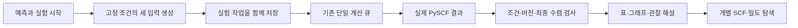
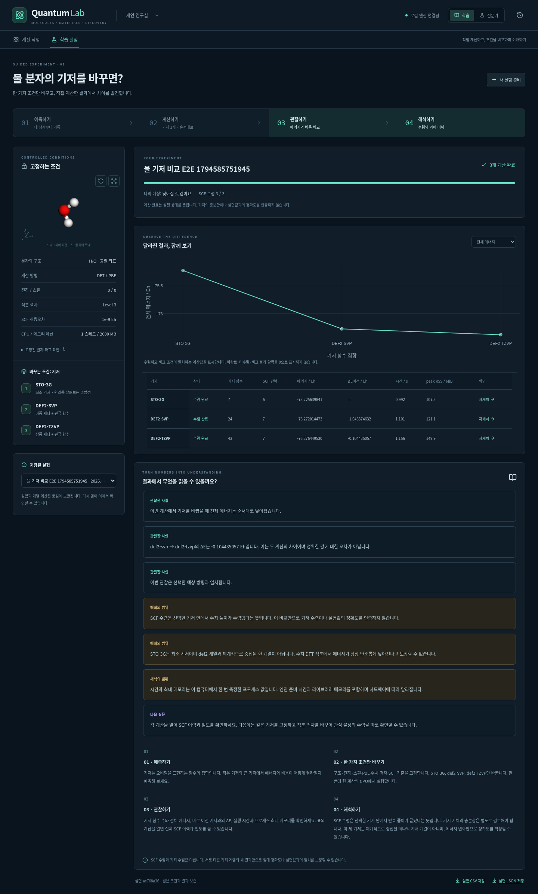

# v0.2 개발 기록: 물 분자의 기저 비교 실험

## 출발점과 이번 작업

게시된 v0.1 소스와 검증 자료를 기준 커밋 `f645a11`로 기록했다. 이번 작업은
**물의 기저 세 가지를 한 번에 비교하는 학습 실험**이다. 기존 계산 작업,
취소·저장·재접속, 분자·결정 엔진을 그대로 이용한다.

첫 실험의 조건은 다음과 같다.

| 고정하는 항목 | 값 |
| --- | --- |
| 물 구조 / Å | O (0,0,0), H (0,−0.757,0.587), H (0,0.757,0.587) |
| 전하·스핀 | 0, 0; 닫힌껍질 |
| 계산 | 고정 구조 RKS/PBE 단일점 |
| 적분 격자 | PySCF grid level 3 |
| SCF 기준 | conv_tol=1e−9, max_cycle=80 |
| 자원 | 1 CPU 스레드, 2000 MB 메모리 예산(강제 메모리 제한 아님) |
| 바꾸는 항목 | STO-3G → def2-SVP → def2-TZVP |

기저 함수 수, 전체 에너지, 바로 이전 기저와의 부호 있는 ΔE, SCF 반복 수,
작업 프로세스 실행 시간과 최대 RSS를 표시한다. 계산된 수치만 사용하며
예제 결과나 그래프를 임의로 채우지 않는다.

## 구현 순서와 역할

1. **기준 버전 기록:** 변경 전 소스·잠금 파일·기존 검증 자료를 Git으로 보존.
2. **과학적 규칙:** 고정 입력 생성, 결과 간 비교 가능성, ΔE와 관찰 문장 작성.
3. **실험 관리:** 실험과 세 작업을 함께 저장하고 기존 계산 큐에서 순서대로 실행.
4. **사용자 화면:** 예측 → 실행 → 관찰 → 해석, 이력·취소·재접속·개별 계산 열기.
5. **검증:** 실패·취소·중복 요청과 수치 비교를 자동 검사하고 실제 브라우저로 확인.

과학적 규칙, 백엔드, 화면, 독립 테스트를 나누어 작업하고, 공유 응답 형식을
먼저 정했다. 기존 결과와 동일한 물리량·단위를 사용하는지 통합 과정에서 확인한다.



## 중요한 구현 결정

- **하나의 실험, 세 개의 독립 계산:** 각 계산의 전체 입력·결과·기저 정의·로그를
  보존하면서 실험의 고정된 순서로 묶는다. 대기열에는 기존 일반 작업도 함께 존재할 수 있다.
- **재전송과 새 실행 구분:** 시작 요청의 고유 ID가 같으면 기존 실험을 돌려준다.
  같은 ID로 설정을 바꾼 요청은 거부한다. 새 실험은 새 ID로 생성한다.
- **기존 데이터 보존:** SQLite에 실험과 멤버십 테이블만 추가한다. 기존 작업을
  다시 계산하거나 기존 테이블의 내용을 바꾸지 않는다.
- **실패한 중간값 건너뛰지 않기:** 가운데 계산이 미수렴이면 그 양쪽의 인접 ΔE는
  비워 둔다. 첫 계산과 마지막 계산을 임의로 이웃처럼 연결하지 않는다.
- **비교 조건 확인:** 기저와 이름 이외의 입력, 결과 구조·방법, 엔진과 관련
  라이브러리 버전을 확인한다. 조건이 다른 값을 같은 비교 그래프에 넣지 않는다.
- **성공의 의미 구분:** 세 번의 SCF가 수렴했다고 기저 수렴 또는 실험값의 정확도를
  인증하지 않는다. STO-3G와 def2는 체계적으로 중첩된 한 기저 계열이 아니다.
- **측정 범위 명시:** 실행 시간은 작업 프로세스 안의 엔진 준비를 포함하며,
  메모리는 라이브러리를 포함한 프로세스 최대 RSS이다. 한 번의 측정을 성능 보장으로 해석하지 않는다.

## API와 저장 자료

`/api/experiments/templates`는 고정 실험 조건과 안내를 제공한다.
`POST /api/experiments`는 `template_id`, `name`, `prediction`, `request_id`를 받는다.
생성된 실험은 `/api/experiments/{id}`에서 이력과 진행·결과를 다시 읽을 수 있다.
`POST .../{id}/cancel`은 이 실험의 대기·실행 중 작업만 취소한다.
`GET .../{id}/export?format=json|csv`는 저장된 입력과 결과 또는 비교 표를 제공한다.

해석 문장은 현재 결과에서 생성하고 해석 규칙 버전을 함께 기록한다. 이미 생성한
실험의 기준 조건은 데이터베이스에 저장한 입력을 사용한다.

## 검증 기록

2026-11-14(한국 시간), 현재 Linux 환경에서 실행했다. 이전 v0.1 기록과 구분한다.

| 검사 | 실제 결과 |
| --- | --- |
| 전체 Python 테스트 | **129개 통과, 48.09초**, 실패·건너뜀 없음 |
| 실제 물 계산의 수치 비교 | 세 작업 모두 직접 PySCF 호출과 `1e-8 Eh` 이내 일치 |
| 과학적 비교 규칙 | 부호 있는 증가·감소, 중간 실패, 비유한 값, 조건·버전 불일치 포함 |
| 실험 API와 저장 | 중복 요청, 전체 생성의 원자성, 취소, 재시작, 부분 파일 내보내기 포함 |
| 새 브라우저 시나리오 | **5개 통과**: 실제 계산·내보내기, 응답 유실 재시도, 취소, 모바일, 실패 표시 |
| 기존 브라우저 회귀 | **4개 통과, 32.0초**: 분자·결정·모바일 오류·TDA/NTO |
| 정적 검사와 빌드 | Ruff, TypeScript·Vite, `git diff --check` 통과 |

브라우저 신규 검사는 첫 실행에서 4개가 통과했고 화면 전환의 지연 resize 오류를
검출했다. 수정 후 실제 계산 흐름과 실패 표시의 2개 검사를 다시 실행해 통과했다.
따라서 위 5개는 서로 다른 시나리오의 통과 수이며, 한 번에 실행한 시간으로 합산하지 않는다.
실패·조건 불일치 화면만 명시적인 UI fixture를 사용하고, 계산·재시도·취소는 실제 API와
엔진으로 실행했다. Python 테스트에는 Starlette의 httpx 사용 관련 deprecation 경고가 남는다.

### 실제 계산에서 관찰한 값

아래 값은 브라우저가 생성한 실험 `ac768a36-1833-4f42-8036-2daf22d0e160`의
저장된 결과다. PySCF 2.15.0, 위 고정 조건을 사용했다.

| 기저 | 기저 함수 수 | SCF 반복 | 전체 에너지 / Eh | 바로 이전 기저와의 ΔE / Eh |
| --- | ---: | ---: | ---: | ---: |
| STO-3G | 7 | 6 | −75.225639841 | — |
| def2-SVP | 24 | 7 | −76.272014473 | −1.046374632 |
| def2-TZVP | 43 | 7 | −76.376449530 | −0.104435057 |

세 에너지는 순서대로 낮아졌다. 마지막 두 계산의 차이는 약 −0.104435 Eh이며,
이를 정확한 에너지에 대한 오차나 기저 수렴 인증으로 해석하지 않는다. 각 실행의
실제 시간·메모리·전체 입력·기저 정의는 앱의 JSON 내보내기에 포함된다.



### 검증 중 발견하고 수정한 문제

1. **화면 전환 후 그래프 크기 조정:** Plotly가 사라진 DOM에 지연 resize를 수행했다.
   표시되지 않는 차트의 요청을 막고, 화면 전환 중 이미 예약된 요청의 종료를 처리했다.
2. **실행 중 JSON 내보내기:** 기저 파일을 쓰는 순간 읽으면 불완전한 JSON일 수 있다.
   저장된 계산·이력은 내보내고 읽을 수 없는 선택 파일의 사유를 함께 기록한다.
3. **기존 TDA 회귀:** 최초 전체 검사에서 기존 TDA 계산이 미수렴했다.
   원인은 지나치게 작은 Davidson 종속성 기준이었다. 수치 정밀도 하한을 추가하고
   저장된 고유벡터의 잔차와 전체 응답 행렬의 직접 대각화 결과를 확인했다.
   사용자 허용오차는 완화하지 않았다. 자세한 설정은 [검증 기록](validation.md)에 남겼다.

### 코드를 따라가는 순서

| 위치 | 확인할 내용 |
| --- | --- |
| `src/quantum_lab/experiment_science.py` | 고정 입력, 비교 제외 규칙, ΔE와 해석 문장 |
| `src/quantum_lab/storage.py` | 실험·세 작업의 원자적 저장과 재전송 처리 |
| `src/quantum_lab/experiments.py` | 생성·조회·취소·내보내기 API |
| `frontend/src/ExperimentLab.tsx` | 예측·실행·관찰·해석 화면과 기록 복원 |
| `tests/test_experiment_science.py` | 실제 계산과 직접 엔진 호출의 수치 비교 |
| `tests/test_experiments_api.py` | 데이터 보존·실패·취소·중복 요청 검증 |
| `frontend/e2e/experiments.spec.ts` | 실제 브라우저 사용자 흐름 |

재현하려면 서버를 실행한 상태에서 다음 명령을 사용한다.

```bash
uv run pytest
npm --prefix frontend run build
npm --prefix frontend run test:e2e
```

이번 변경은 검토할 수 있는 작업 트리에 남겼고 게시하지 않았다. 실제 Windows WSL2와
독립 프로그램의 물리적 교차 검증은 별도 과제로 남아 있다. 다음 학습 실험은 같은
기저에서 적분 격자를 바꾸는 비교로 확장할 수 있다.
