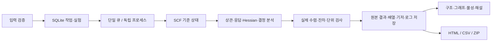

# v0.3 개발 기록: 계산 방법·물성·학습 실험 확장

## 이번 구현의 범위

v0.2의 저장 작업·순차 큐·SSE·분자와 결정 엔진을 유지하면서, 설치된 PySCF에서
실행하고 검증할 수 있는 계산을 화면과 연결했다. 계산 방법 이름만 추가하지 않고
입력 제한, 실제 실행, 중간·최종 상태, 산출물, 설명, 실패 검증까지 구현했다.
환경 게시나 외부 공개는 수행하지 않았다.

| 영역 | 구현된 기능 | 구분해야 하는 한계 |
| --- | --- | --- |
| 전자 상관 | MP2, CCSD, CCSD(T), CISD | 닫힌껍질 RHF 기준 단일점, 동결 점유 궤도 지정 |
| 다중배치 | FCI, CASCI, CASSCF, strongly-contracted NEVPT2 | NEVPT2는 CASCI 기준. 초기 활성 공간은 정준 RHF의 연속 궤도 |
| 여기 상태 | HF-TDA(CIS), TDHF, singlet EOM-EE-CCSD | EOM은 여기 에너지만 계산하며 전이 세기·NTO 미제공 |
| 분자 물성 | Mulliken·Löwdin 전하, 쌍극자·스핀 진단 | 상관 작업에서도 저장 밀도·궤도·전하는 RHF 기준 |
| 조화 진동 | HF·PBE·PBE0·B3LYP Hessian, 정상 모드, 허수 진동 | 2~30원자 닫힌껍질, ECP 미지원, 실제 동역학 아님 |
| IR | ±0.005 bohr 변위의 실제 SCF 쌍극자 중앙 차분 | 6N회 추가 SCF. 하나라도 미수렴하면 세기를 성공값으로 제공하지 않음 |
| 열화학 | ZPE, 이상 기체 RRHO의 E/H/G/S/Cv/Cp | 정지점·양의 진동 모드 확인 필요, 비조화·용매 효과 미포함 |
| 결정 물성 | DOS·점유 DOS·상태/전자 수 적분, 표본 직접·간접 갭 | DOS는 균일 SCF k격자, 광학 스펙트럼이 아님 |
| 학습 실험 | 기저·격자·함수형·거리·k점·FFT·상관 방법 7종 | 낮은 에너지순으로 다른 근사 방법의 정확도를 평가하지 않음 |
| 결과 활용 | 인쇄용 HTML, 물성 CSV, SHA-256 재현 ZIP | 과거 실행 환경과 현재 설치 환경이 같다고 가정하지 않음 |
| 실행·설치 | 명령행 실행·진단·예제, 화면 포함 wheel 패키지 | 실제 Windows WSL2 검증과 외부 배포 승인은 별도 |

## 개발 과정

1. **입력과 결과 계약부터 확장했다.** 상관 방법의 에너지와 RHF 기준 물성을 분리하고,
   진동수·정상 모드·DOS의 단위를 고정했다. API에서 지원하지 않는 조합을 거부한다.
2. **계산 모듈을 병렬 구현했다.** 상관·응답, 진동·전하, 결정 물성, 실험 관리와
   두 화면 영역을 나누고, 독립 직접 엔진 호출과 비교했다.
3. **최종 성공 조건을 연결했다.** SCF뿐 아니라 CC/CAS/EOM·진동 응답·선택적 IR의
   수렴을 확인한다. 내부 응답이 유한한 배열을 반환했다는 사실만으로 성공 처리하지 않는다.
4. **이전 기록을 보존했다.** SQLite의 새 실험 정의 열을 추가하고 v0.2 기록은 당시
   저장한 입력만으로 복원한다. 새 기본값을 과거 계산에 주입하지 않는다.
5. **실제 사용자 흐름으로 확인했다.** 최적화한 구조를 진동 계산으로 옮기고,
   정상 모드를 선택·표시하고, 계산 보고서와 재현 묶음을 다운로드했다.
6. **설치 산출물을 분리했다.** 작업 소스를 바꾸지 않는 임시 staging에서
   프런트엔드 자산이 포함된 wheel을 만들고, 새 가상환경에서 확인한다.

## 검증에서 발견한 문제와 수정

- **최적화 좌표의 반올림:** 좌표 편집창은 간단한 자릿수로 표시하지만, 재실행 시
  그 문자열을 읽으면 원래 정밀도가 줄었다. 사용자가 수정하지 않은 좌표는 저장된
  수치를 그대로 전달하도록 바꾸고 최적화→진동 브라우저 검사로 확인했다.
- **Hessian 응답의 수렴:** 내부 Krylov 풀이기가 경고 후 벡터를 반환할 수 있다.
  반환 벡터의 실제 응답 잔차를 다시 계산하고 허용오차 초과 시 실패 처리한다.
  `hessian-response.json`에 확인 결과가 남는다.
- **구조 전환 시 누적 회전:** 3D 카메라의 회전을 구조가 바뀔 때마다 더하면
  결합을 정면에서 보게 되어 두 원자가 겹쳐 보일 수 있었다. 초기 방향은 한 번만
  적용하고 이후 구조 전환에서 사용자의 방향을 유지한다.
- **비교의 누락 메타데이터:** 버전이 양쪽 모두 없거나 좌표가 유한하지 않은 결과를
  일치로 처리하지 않도록 했다. 미수렴 상관 에너지는 중간값으로 표시한다.
- **밴드와 DOS의 에너지 기준:** 밴드는 SCF+밴드 경로에서 찾은 VBM, DOS는
  균일 SCF k격자의 VBM이 기준이다. 화면과 CSV에 기준을 구분해 남긴다.
- **IR 곡선의 해상도:** 실제 stick 세기는 유지하면서 선택한 표시 폭에 맞게
  곡선 표본 수를 조정했다. 좁은 선폭에서 봉우리가 표본 사이에 빠지지 않게 한다.

## 실제 화면

[전자 상관](images/correlation-workspace.png) · [진동·IR·정상 모드](images/vibrations-workspace.png) ·
[결정 DOS](images/dos-workspace.png) · [H₂ 결합 거리 곡선](images/experiment-scan.png) ·
[DFT 격자 비교](images/experiment-grid.png) · [결정 FFT 비교](images/experiment-crystal.png)

그림은 모두 이 환경에서 실행한 실제 결과다. 학습 실험의 오류 표시를 검증하는
일부 브라우저 테스트만 명시적인 fixture를 사용하며, 이를 수치 검증으로 세지 않는다.

## 검증 기록

2026-11-14(한국 시간) Linux에서 전체 Python 검사 **278개가 138.82초에 통과**했다.
실패·건너뜀은 없었고 Starlette의 httpx 사용 관련 deprecation 경고가 있었다.
후속 패키징 **4개**와 실행 환경 기록 **3개**도 별도 실행에서 통과하여 현재 서로 다른
Python 검사 **285개**의 통과를 확인했다. 브라우저 **18개 시나리오**, 최종 빌드의
관련 회귀 **5개(43.1초)**도 통과했다. 이 실행들을 하나의 측정 시간으로 합산하지 않는다.
새 Linux 가상환경에 잠금 의존성 42개와 wheel을 설치하고, 저장소 밖에서 실제 HTTP·화면·H₂
계산을 확인했다. 상세 확인 결과는 [검증 기록](validation.md)에 정리했다.

새 작업은 `environment.json`과 결과의 `run_environment`에 앱·Python·의존성 버전과
시작 시점의 Python 소스 SHA-256을 기록한다. 계산 실패 시에도 환경 파일은 남는다.
과거 작업에는 새 버전 정보를 소급 기록하지 않는다. 설치 후 실행한 작업의 소스 해시
21개가 패키지 manifest와 일치함을 확인했다.

핵심 수치 검사는 다음을 포함한다.

- MP2·CC·CI·CAS·NEVPT2 에너지와 직접 PySCF 호출의 일치, 동결 궤도와 비활성 핵심 처리.
- EOM 여기 에너지, 저장한 오른쪽 고유벡터의 실제 잔차, 미수렴 EOM과 CC 바닥상태 구분.
- 직접 Hessian/에너지 곡률, 정상 모드의 질량 정규화, 전하 보존, IR 단위 변환과 쌍극자 미분.
- 결정 Γ·2³ 직접 호출, DOS의 스핀·k가중치·상태 수·전자 수 적분.
- H₂ 거리 5점, 결정 FFT 15³/21³/27³, k점 Γ/2³/3³, 물 HF/MP2/CCSD의 실제 저장 큐 실행.
- 실패·취소·중복 요청·과거 데이터 복원·부분 파일·HTML escaping·ZIP 체크섬.

직접 PySCF와 어댑터의 일치는 **서로 다른 엔진 간 물리적 교차 검증이 아니다.**
각각의 입력·방법·기저 밖으로 검증 결과를 확대해 보증하지 않는다.

## 코드를 읽는 순서

| 파일 | 역할 |
| --- | --- |
| `models.py` | 방법·작업·활성 공간·IR·열화학 입력 제한 |
| `engines/correlated.py` | 상관 방법·NEVPT2·EOM·자원 추정과 수렴 |
| `engines/properties.py` | 전하·Hessian·응답 잔차·IR·RRHO |
| `engines/periodic_analysis.py` | DOS와 표본 밴드 끝점 |
| `experiment_science.py` | 7종 실험의 고정 조건·비교·해설 |
| `reports.py` | 보고서·단위가 있는 CSV·재현 ZIP |
| `cli.py` | 명령행 실행·진단·예제 |
| `PropertiesResults.tsx`, `Viewer.tsx` | 고급 결과와 정상 모드 표시 |
| `ExperimentLab.tsx` | 주제별 실험·선택 구조·이력·해석 |
| `scripts/package_release.py` | 화면을 포함하는 로컬 설치 패키지 생성 |

## 남은 작업과 실제 결정이 필요한 항목

구현 가능한 기능이 더 이상 없다는 뜻은 아니다. 일반적인 기능 확장과 설치 검증은
계속할 수 있으며, 아래 선택에 따라 다음 큰 개발 범위가 달라진다.

| 구분 | 남은 내용 | 필요한 정보·판단 |
| --- | --- | --- |
| 실제 사용자 장비 검증 | Windows WSL2 설치·메모리·브라우저·중단 복원 | 실제 Windows 장비에서 실행한 기록 |
| 독립 검증·외부 엔진 | Psi4, QE/GPAW/CP2K, xTB 등 | 목표 물성·시스템·실행 자원에 따라 우선순위 선택. 공개 엔진 연결 자체에 별도 승인이 필요한 것은 아님 |
| 상용 엔진 | ORCA·Gaussian 사용자 설치본 연결 | 합법적인 설치 접근과 해당 사용·배포 조건 |
| GW/BSE | 시작점·screening·수렴·비교 기준 | 분자/재료, 준입자/광학 물성, 정확도 목표 |
| 실제 S₁→S₀ 동역학 | 상태 간 결합·핵 운동·앙상블·검증 관측량 | 목표 현상과 FSSH/Ehrenfest 등 모델 선택 |
| 외부 공개·공유 서비스 | 라이선스·인증·다중 사용자·배포 | 개인/연구실 범위를 넘어설지 결정 |

이 항목을 대신 선택한 것처럼 표시하거나, 검증하지 않은 Windows·상용 엔진·실제
동역학을 지원 완료로 표시하지 않았다. 현재 버전은 작은 계를 계산하고 원본 조건과
수렴 상태를 확인하며 결과를 해석·보관하는 로컬 연구·학습 프로그램이다.
